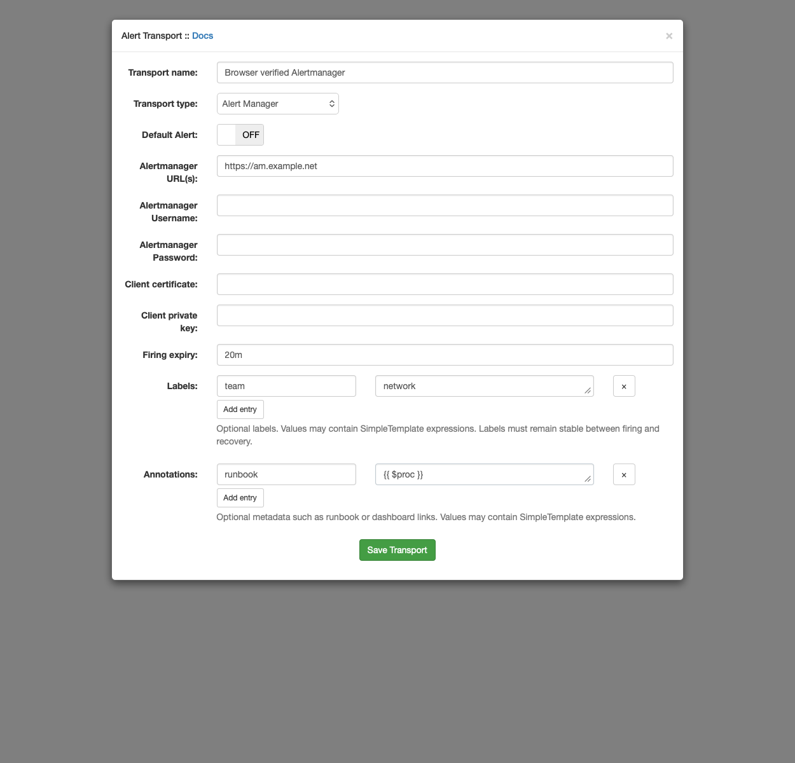

## Alertmanager

Alertmanager groups, deduplicates and routes alerts using their labels.
Configure one or more comma-separated base URLs; LibreNMS posts each delivery
at `/api/v2/alerts` on every endpoint. Optional Basic authentication uses the
configured username and password.

### Labels and annotations

Use **Add entry** to enter a name and value in the Labels or Annotations section.
Names must start with a letter or underscore and contain only letters, numbers
and underscores. Duplicate names are rejected when saving.

Values can be plain text or SimpleTemplate expressions using alert data:

| Section | Name | Value |
| --- | --- | --- |
| Labels | source | `librenms` |
| Labels | team | `network` |
| Labels | priority | `{{ $severity\|replace('critical','3')\|replace('warning','4')\|replace('ok','') }}` |
| Annotations | runbook | `{{ $proc }}` |
| Annotations | dashboard | `https://grafana.example.net/d/device?var-device={{ $hostname\|url_encode }}` |

Whitespace around evaluated values and HTML markup are removed. Empty evaluated
values are omitted; the string `0` is preserved. Explicit entries override
built-in or legacy entries with the same name.

Labels define alert identity in Alertmanager. Values must remain the same between
firing and recovery: changing a label creates a different alert. Use annotations
for changing readings, elapsed times, titles and other descriptive information.

### Firing expiry

**Firing expiry** optionally specifies how long Alertmanager keeps an alert firing
after each delivery. Enter a positive whole duration followed by `s`, `m`, `h` or
`d`, for example `30s`, `20m`, `2h` or `1d`. A value of `20m` sets `endsAt` to the
delivery time plus 20 minutes. Compound durations such as `1h30m` are not supported.

The field also accepts a SimpleTemplate expression resolving to such a duration.
It is expanded once using alert data, then validated. A blank field or blank
result omits firing `endsAt`, allowing Alertmanager's configured `resolve_timeout`
to apply. An invalid nonblank result fails this transport delivery and is logged.
Invalid literal durations are rejected when saving.

This does not create a heartbeat. Configure repeat notifications to arrive before
expiry. Notification limits, maintenance or delivery failures can allow an active
alert to expire. Recovery always sends a past `endsAt`, independently of the
firing expiry setting, so an invalid firing expiry cannot block recovery.

### Client certificates and request settings

For mutual TLS, provide paths to a PEM client certificate and a separate,
unencrypted PEM private key. Both must be readable by the process sending alerts.
Paths refer to files on each poller/dispatcher performing deliveries, not the
browser's computer. A missing or unreadable file produces a delivery failure.

Every endpoint request uses a 30-second timeout and LibreNMS's HTTP proxy,
`no_proxy` and User-Agent settings. Earlier versions did not pass all client
settings into pooled requests; ensure internal Alertmanager endpoints are in
`no_proxy` where required. TLS server certificate verification remains enabled.

### Delivery failures

All configured endpoints are attempted. If any fail, delivery is reported as a
failure even if others succeeded. The existing device event log and application
log receive one summary with the failed/total count, success count, and up to five
failed endpoint identifiers and their HTTP status or failure classification.
URL credentials, query parameters and raw response bodies are excluded. Longer
summaries state how many additional failures were omitted. Other transports
continue normally; this does not introduce automatic retries or quorum rules.

### Existing Options configuration

Transports with **Legacy Alertmanager Options** retain their existing behaviour.
Each newline-separated `name=value` is evaluated as before: values resolve from
alert data, then faults, and otherwise remain literal. A `stc_` name is static and
has that prefix removed; a `dyn_` name is omitted when no value resolves and
retains its prefix when sent. This is independent of the new row-based entries.

Legacy options are shown only when present. They are not automatically converted
because their lookup and fallback rules differ from SimpleTemplate. New labels
with the same outgoing name take precedence. Installations running earlier
versions of the unmerged enhancement can still load newline-based labels and
annotations; saving through the editor stores them as structured entries.

[Alertmanager documentation](https://prometheus.io/docs/alerting/latest/alertmanager/)
